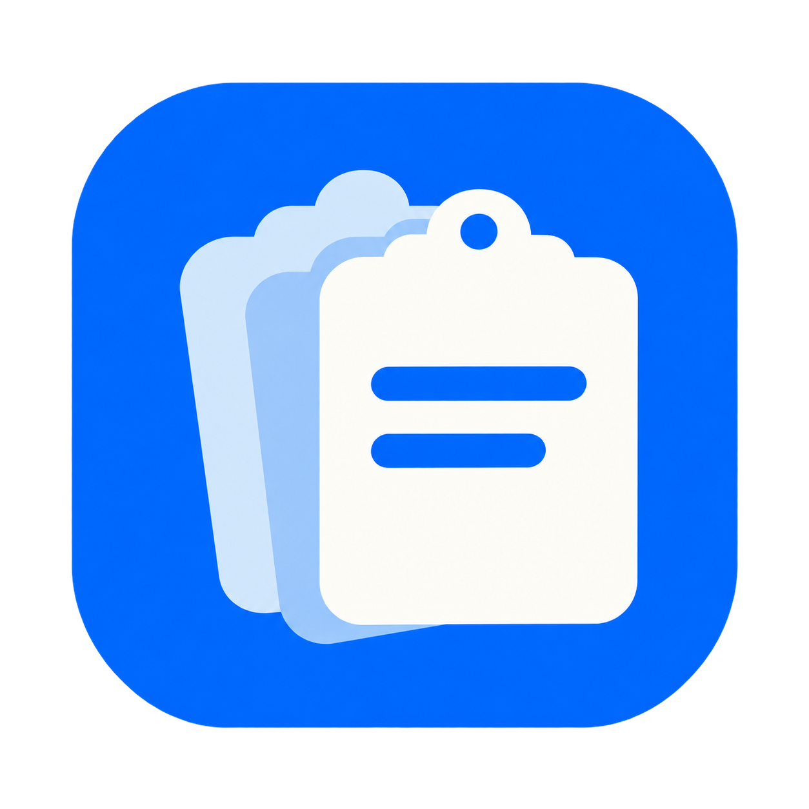
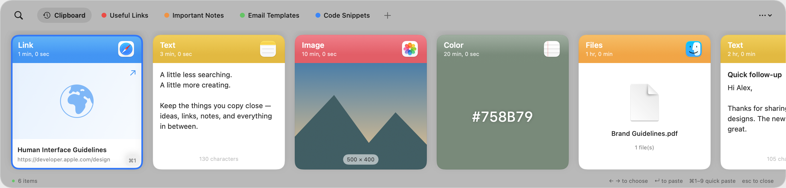

<p align="center">
  
</p>

<h1 align="center">ClipNest</h1>
<p align="center"><strong>Giữ lại những gì bạn copy. Tìm lại ngay khi cần.</strong></p>
<p align="center">Một ứng dụng clipboard gọn gàng dành cho Mac, được tạo bởi <a href="https://github.com/hieupnvmg">hieupn</a>.</p>
<p align="center"><a href="https://github.com/hieupnvmg/ClipNest/releases/latest/download/ClipNest-0.5.1-Apple-Silicon.dmg"><strong>↓ Tải ClipNest cho Mac</strong></a> · Apple Silicon · macOS 13 trở lên</p>



Bạn vừa copy một đường link, rồi copy tiếp một đoạn văn và mất nội dung trước đó? ClipNest giữ lại lịch sử để bạn có thể tìm và dùng lại bất cứ lúc nào.

### Có gì trong ClipNest?

- **Lịch sử clipboard:** lưu văn bản, đường link, ảnh, mã màu và tham chiếu file.
- **Tìm kiếm tức thì:** mở bằng `⌘⇧V`, gõ từ khóa và nhấn `Enter` để dán.
- **Pinboard:** gom ghi chú, link và nội dung hay dùng vào từng nhóm riêng.
- **Dán theo cách bạn muốn:** giữ định dạng hoặc dán văn bản thuần.
- **Giao diện gọn:** các thẻ nội dung hiện ở cạnh dưới màn hình; nhấn `Esc` một lần để đóng.
- **Cập nhật trong app:** tự kiểm tra bản mới hoặc nhấn Check for Updates trong Settings.
- **Độ trong suốt theo ý bạn:** chỉnh nền bằng thanh kéo, áp dụng ngay.
- **Phím tắt tùy chỉnh:** đổi tổ hợp mở clipboard trong Settings, mặc định `⌘⇧V`, có nút khôi phục.
- **Chủ động quản lý:** tạm dừng ghi nhận, loại trừ ứng dụng, xem dung lượng và xóa lịch sử trong Settings.
- **Tự bảo vệ nội dung nhạy cảm:** bỏ qua mật khẩu/khóa nhận diện được, che thông tin cá nhân và chỉ hiện tạm khi bạn yêu cầu.

### Cài đặt

1. [Tải file DMG](https://github.com/hieupnvmg/ClipNest/releases/latest/download/ClipNest-0.5.1-Apple-Silicon.dmg).
2. Mở file, kéo **ClipNest** vào **Applications**.
3. Mở ClipNest và bắt đầu copy. App nằm trên menu bar.
4. App tự nhắc cấp quyền Accessibility nếu chưa có. Để dán thẳng sang ứng dụng khác, bật ClipNest tại **System Settings → Privacy & Security → Accessibility**. Nếu chưa cấp quyền, chọn một mục rồi nhấn `⌘V` để dán.

Bản hiện tại: **0.5.1**, dành cho **Mac M1 trở lên, macOS 13+**. Chưa có bản Mac Intel. App chưa được Apple notarize; nếu macOS chặn do chưa xác minh nhà phát triển, xem [hướng dẫn mở app của Apple](https://support.apple.com/en-au/102445).

### Phím tắt

| Phím | Thao tác |
| --- | --- |
| `⌘⇧V` | Mở / đóng ClipNest |
| Gõ ngay sau khi mở | Tìm trong lịch sử |
| `Enter` | Dán mục đang chọn |
| `←` / `→` hoặc `↑` / `↓` | Chọn nội dung ngay cả khi đang ở ô tìm kiếm |
| `⌘1` đến `⌘9` | Dán nhanh một trong chín mục đầu |
| `⌘F` | Quay lại ô tìm kiếm |
| `Esc` | Đóng bảng clipboard |

### Cập nhật và giao diện

Từ bản 0.4.0, bạn có thể kiểm tra và cài bản mới ngay trong **Settings → Updates**. App tự kiểm tra hằng ngày khi tùy chọn này được bật; bạn xác nhận trước khi cài. Người đang dùng 0.3.1 trở về trước cần cài bản 0.4.0 thủ công một lần.

Trong **Settings → Appearance**, kéo thanh độ trong suốt để chỉnh nền cho dễ nhìn. Lựa chọn được lưu tự động.

### Đổi phím tắt

Mở **Settings → Open Clipboard → Change…**, sau đó nhấn tổ hợp bạn muốn dùng. Cần kết hợp Command, Option hoặc Control với một phím; nhấn Esc để hủy. Lựa chọn được lưu tự động. Nút **Reset** đưa về `⌘⇧V`. Nếu phím tắt đang bị ứng dụng khác chiếm, app sẽ báo để bạn chọn lại.

### Dữ liệu ở trên máy bạn

**Tự bảo vệ nội dung nhạy cảm** bật mặc định trong Settings. App dùng quy tắc trên máy để bỏ qua mật khẩu có ngữ cảnh, token/API key, private key và thông tin xác thực nhận diện được. Email, số điện thoại và số thẻ hợp lệ được che trên thẻ; bạn có thể chọn **Không lưu** những thông tin này thay vì che.

Nút **Hiện 15 giây** chỉ mở tạm nội dung, sau đó tự che lại; đóng bảng cũng che lại ngay. Bạn vẫn dán được bản gốc. Kéo thả và chỉnh sửa mục đang che yêu cầu hiện tạm trước.

Chế độ che vẫn giữ dữ liệu gốc trong máy để dán lại, không phải mã hóa. Nội dung cũ chỉ được che khi nhận diện, không tự xóa khỏi lịch sử. Nhận diện có thể nhầm hoặc bỏ sót, đặc biệt là mật khẩu đứng riêng không có dấu hiệu; bản này chưa quét chữ trong ảnh.

ClipNest không cần tài khoản và không đồng bộ iCloud. Lịch sử được lưu cục bộ trên từng Mac, không được app gửi lên máy chủ. App chỉ kết nối GitHub để kiểm tra và tải bản cập nhật; bạn có thể tắt tự kiểm tra trong Settings. App bỏ qua các ứng dụng trong danh sách loại trừ và các nội dung clipboard có đánh dấu bí mật; bạn vẫn nên tạm dừng ghi nhận khi xử lý thông tin nhạy cảm. Lịch sử không có mã hóa riêng ở tầng ứng dụng.

Settings hiển thị dung lượng đang dùng và có nút **Clear**. Clear xóa cả các mục đã ghim sau khi bạn xác nhận. File được lưu dưới dạng tham chiếu; nếu bạn di chuyển hoặc xóa file gốc thì tham chiếu có thể không còn dùng được.

### Góp ý

Bạn gặp lỗi hoặc muốn thêm tính năng? [Tạo một issue](https://github.com/hieupnvmg/ClipNest/issues) để chia sẻ nhé.

<details>
<summary>Dành cho người muốn tự build</summary>

Cần macOS và Apple Command Line Tools có Swift 5.9 trở lên.

```sh
./build.sh
../ClipNest.app/Contents/MacOS/ClipNest --self-test
```

App được tạo ở thư mục bên cạnh repo. Các bài kiểm tra dùng dữ liệu tạm, không thay đổi lịch sử thật. Xem [ghi chú phát triển](docs/DEVELOPING.md) nếu cần thêm thông tin.

</details>
