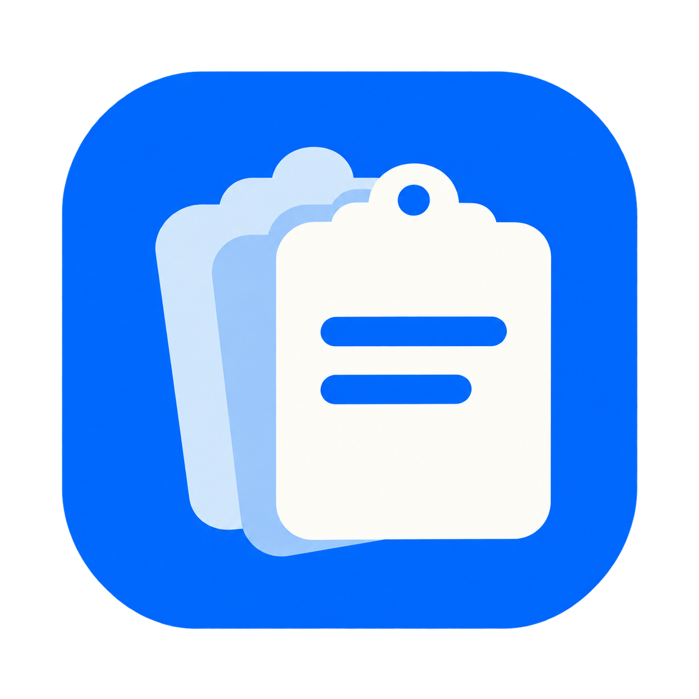
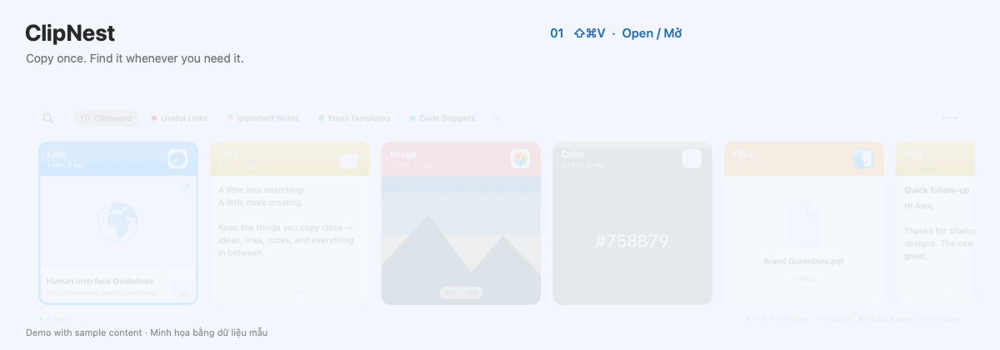
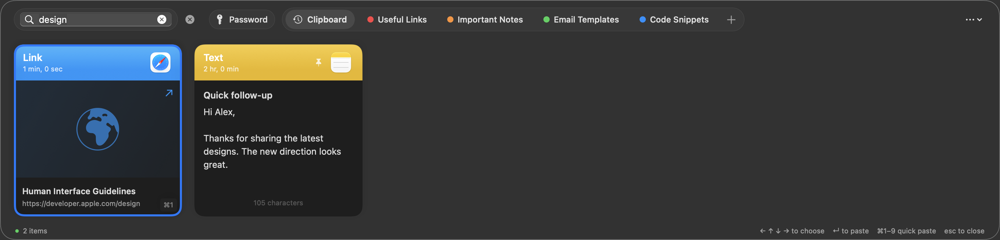
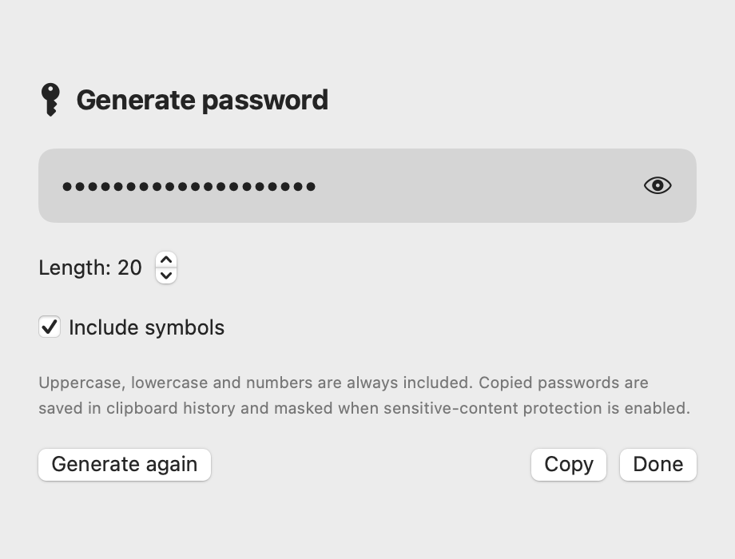
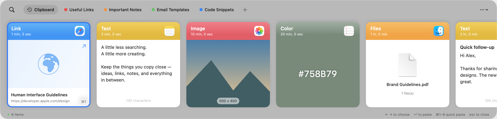
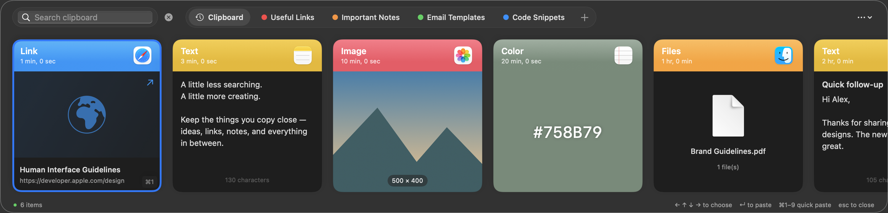

<p align="center">
  
</p>

<h1 align="center">ClipNest</h1>

<p align="center">
  <strong>A clipboard history for your Mac.</strong><br>
  Find the link, screenshot, or snippet you copied earlier and paste it where you need it.
</p>

<p align="center">
  <a href="https://github.com/hieupnvmg/ClipNest/releases/latest"><strong>Download for Mac ↓</strong></a>
  &nbsp; · &nbsp;
  <a href="https://github.com/hieupnvmg/ClipNest/releases">Release notes</a>
  &nbsp; · &nbsp;
  <a href="https://github.com/hieupnvmg/ClipNest/issues">Feedback</a>
</p>

<p align="center">
  macOS 13+ &nbsp; · &nbsp; Apple Silicon &nbsp; · &nbsp; Local clipboard history
</p>



## Get started

1. [Download the latest DMG](https://github.com/hieupnvmg/ClipNest/releases/latest), open it, and drag **ClipNest** into **Applications**.
2. Launch ClipNest and press **`⇧⌘V`** to open the clipboard panel. Start typing to search, use the arrow keys to choose an item, and press **Return** to paste.
3. To paste directly into other apps, enable ClipNest under **System Settings → Privacy & Security → Accessibility**. You can also choose **Copy Only** and paste with **`⌘V`**.

ClipNest runs on Apple Silicon Macs with macOS 13 or later. The current build is distributed without Apple notarization. If macOS blocks the first launch, see [Apple’s guidance on opening apps](https://support.apple.com/102445).

Already installed? Right-click the ClipNest menu bar icon and select **Check for Updates…**.

## What you can do

| Feature | How it works |
| :--- | :--- |
| **Browse clipboard history** | Reuse text, links, images, colors, and file references. Paste with the original formatting or as plain text. |
| **Find the closest match first** | Search prioritizes text or titles that start with your query and match its capitalization. Other prefix matches come next, followed by matches elsewhere in the text or title. App-name-only matches appear last. |
| **Organize with pinboards** | Create boards for notes and reusable snippets. **Useful Links** and **IP Addresses** automatically collect standalone HTTP/HTTPS URLs and valid IPv4 or IPv6 addresses, including CIDR such as `1.1.1.1/32` and `2001:db8::/64`. |
| **Generate passwords** | Use **Password** next to the pinboards to generate and copy a password. Choose a length from 12 to 64 characters and whether to include symbols. |
| **Share text as a link** | Right-click a text item and choose **Push to pikab.in (1 week)…**. Anyone with the resulting link can read the shared text until it expires. |
| **Customize the panel** | Change the shortcut, adjust transparency, or enable **Launch at login**. Native Liquid Glass is available on macOS 26 and later, with a frosted appearance on earlier versions. |

## Features in action

### Find a clip as you type

Type a word such as `design` to narrow the history to matching clips. The selected result is outlined, so you can see what **Return** will paste.



### Generate a password

Open **Password** from the clipboard toolbar. Adjust the length and symbols, then copy the generated password. Use the eye button to reveal it.

<p align="center">
  
</p>

<details>
<summary>Light and dark screenshots</summary>





</details>

## Keyboard shortcuts

| Shortcut | Action |
| :--- | :--- |
| `⇧⌘V` | Toggle the clipboard panel. You can change this shortcut in Preferences. |
| Type after opening | Search clipboard history |
| `←` `→` `↑` `↓` | Select an item |
| `Return` | Paste the selected item |
| `⌘1`–`⌘9` | Paste one of the first nine results |
| `⌘F` | Focus the search field |
| `Esc` | Close the panel |

## Clipboard privacy

Clipboard history stays on your Mac and requires no account. Sensitive-content protection is on by default and can mask recognized emails, phone numbers, payment card numbers, passwords, and tokens on screen. You can reveal a masked item for 15 seconds. ClipNest stores and pastes the original value, and masking provides no app-level encryption.

You can exclude apps, pause capture, or check how much disk space history uses. **Preferences → Clipboard Storage → Clear** deletes history, including pinned items, after confirmation. Original images load from disk on demand.

The **Push to pikab.in** action sends the selected item’s original text to PikaBin. Update checks and downloads use GitHub.

<details>
<summary>Build from source</summary>

On macOS, install Apple Command Line Tools and use Swift 5.9 or later. Native Liquid Glass requires a macOS 26 SDK or newer.

```sh
git clone https://github.com/hieupnvmg/ClipNest.git
cd ClipNest
./build.sh
../ClipNest.app/Contents/MacOS/ClipNest --self-test
```

The build creates `ClipNest.app` next to the repository. The self-test uses temporary data and a private clipboard. [Development notes](docs/DEVELOPING.md)

</details>

<p align="center">
  Made for Mac by <a href="https://github.com/hieupnvmg">hieupn</a>.
</p>
