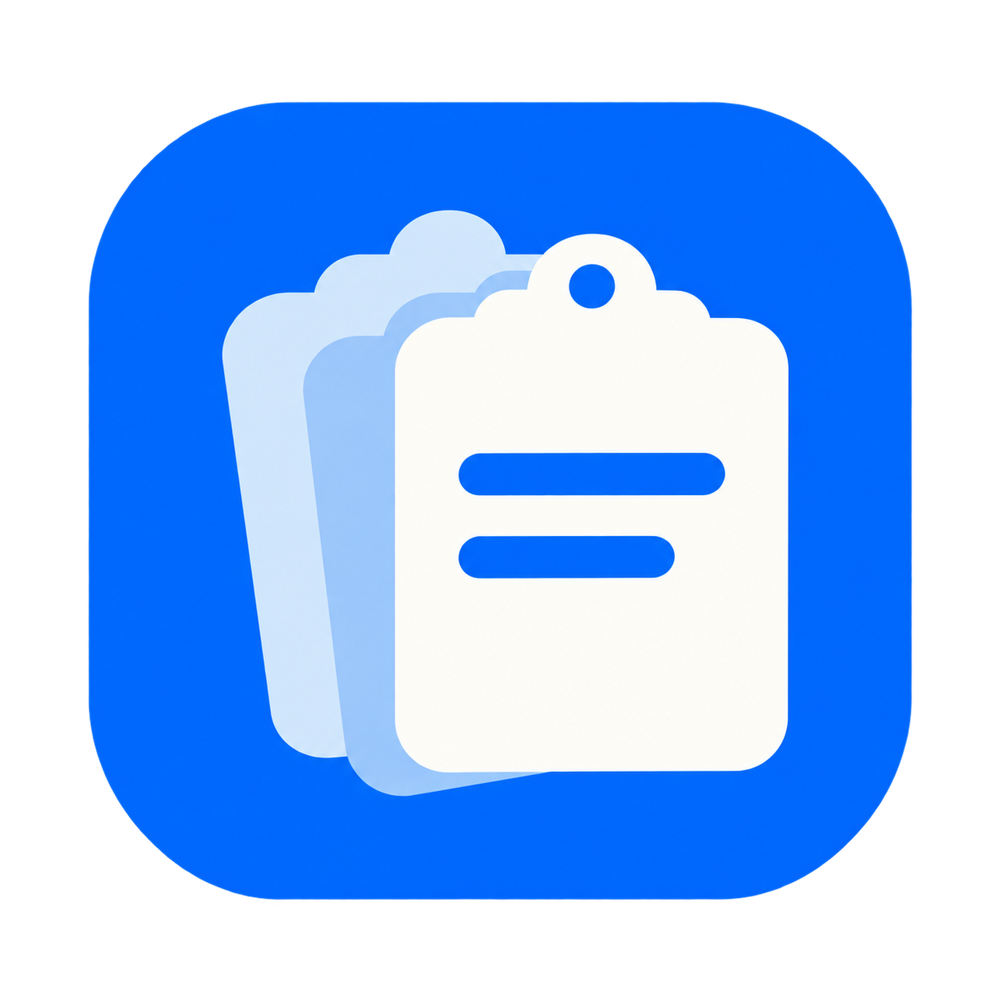
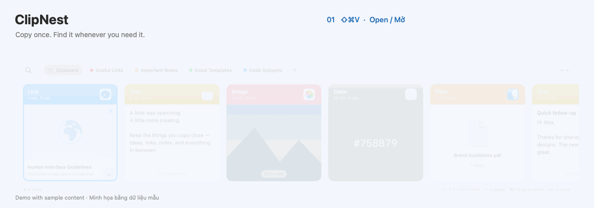
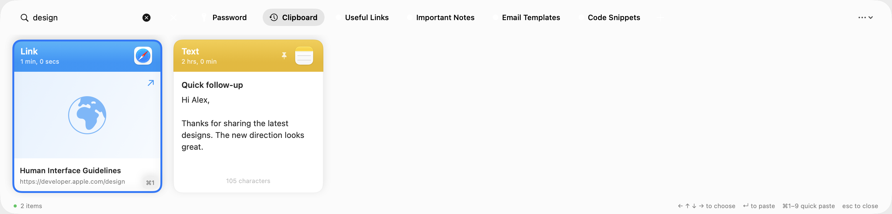
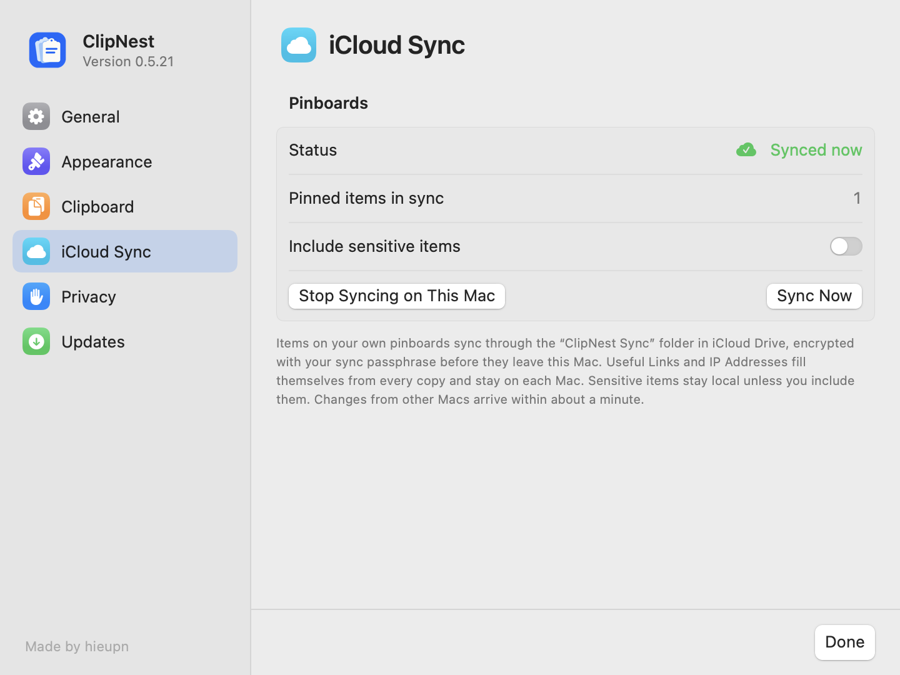
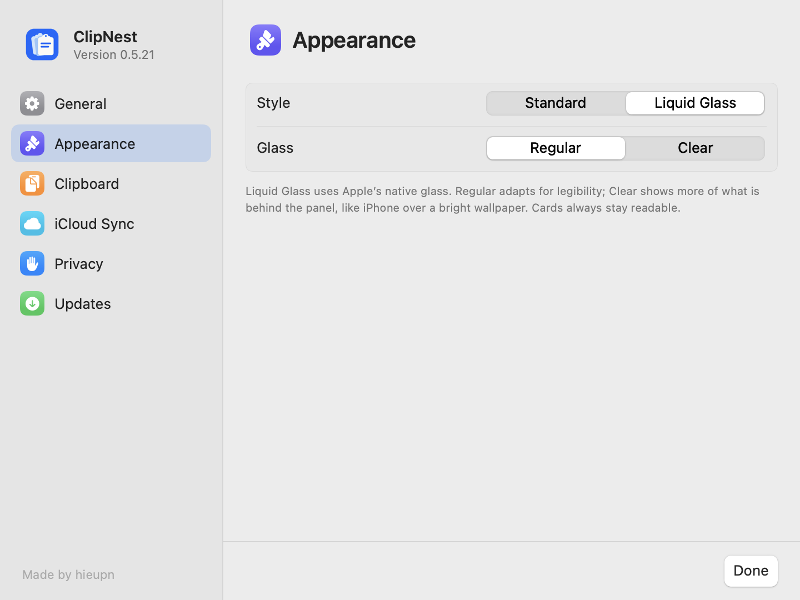
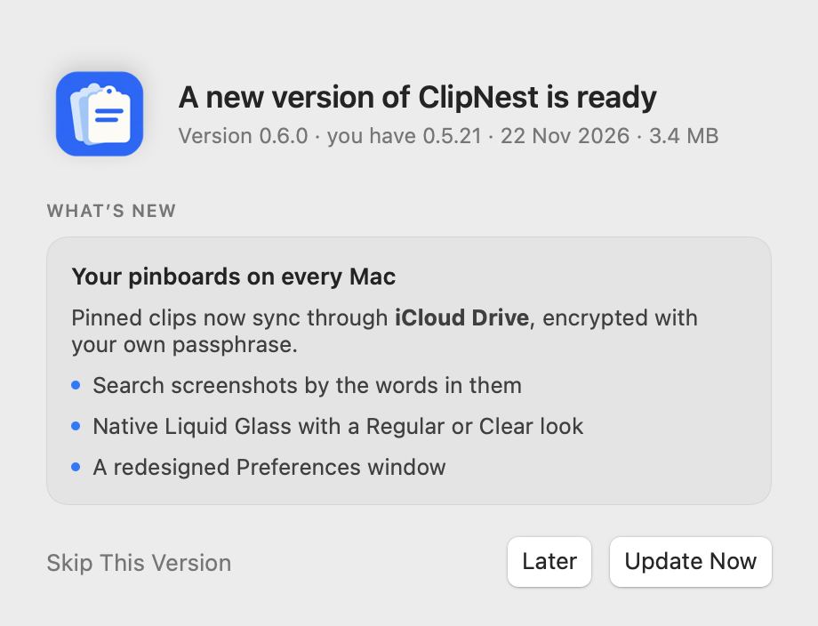
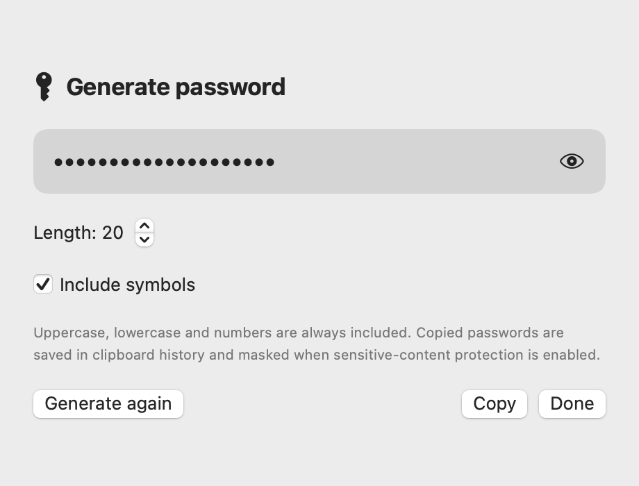
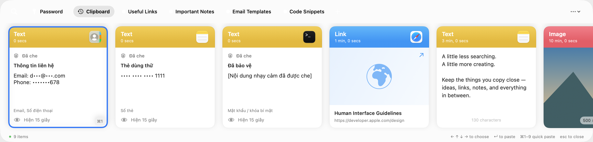

<p align="center">
  
</p>

<h1 align="center">ClipNest</h1>

<p align="center">
  <strong>Everything you copy, one keystroke away.</strong><br>
  A fast, private clipboard history for macOS — with searchable screenshots,<br>
  encrypted iCloud sync for your pinboards, and native Liquid Glass.
</p>

<p align="center">
  <a href="https://github.com/hieupnvmg/ClipNest/releases/latest"></a>
</p>

<p align="center">
  <a href="https://github.com/hieupnvmg/ClipNest/releases/latest"></a>
  <a href="https://github.com/hieupnvmg/ClipNest/releases"></a>
  
  
  
  
</p>

<p align="center">
  <a href="#features">Features</a> ·
  <a href="#get-started">Get started</a> ·
  <a href="#keyboard">Keyboard</a> ·
  <a href="#privacy">Privacy</a> ·
  <a href="#faq">FAQ</a> ·
  <a href="https://github.com/hieupnvmg/ClipNest/releases">Release notes</a>
</p>

<br>



<p align="center">
  <kbd>⇧</kbd> <kbd>⌘</kbd> <kbd>V</kbd> &nbsp;open &nbsp;→&nbsp; type to search &nbsp;→&nbsp; <kbd>↩</kbd> paste
</p>

<br>

<a id="features"></a>

## ✨ Features

<table>
<tr>
<td width="33%" valign="top">

### 🔎 Instant search
Start typing the moment the panel opens. Prefix matches come first, newest clips lead, and every keystroke narrows the results — no lag, even with rich-text clips from the web.

</td>
<td width="33%" valign="top">

### 🖼️ Searchable screenshots
ClipNest reads the text in images with Apple’s Vision, **entirely on your Mac**. Find a screenshot by a word in it, or copy its text with one click. Vietnamese and English.

</td>
<td width="33%" valign="top">

### ☁️ iCloud Sync
Your pinboards follow you to every Mac through iCloud Drive, **end-to-end encrypted** with a passphrase only you know. No account, no server.

</td>
</tr>
<tr>
<td valign="top">

### 🛡️ Secrets stay hidden
Passwords, API tokens, private keys, card numbers, emails and phone numbers are masked on screen — even inside screenshots. Reveal one for 15 seconds when you need it.

</td>
<td valign="top">

### 🫧 Liquid Glass
The panel uses Apple’s system glass on macOS 26+, with a **Regular** or **Clear** look. Earlier versions get a frosted backdrop. Cards always stay readable.

</td>
<td valign="top">

### 📌 Pinboards
Keep snippets on your own boards. **Useful Links** and **IP Addresses** fill themselves — URLs and IPs, CIDR included (`10.0.0.0/8`).

</td>
</tr>
<tr>
<td valign="top">

### 🔑 Password generator
12–64 characters, symbols on or off, copied in one click and masked in history.

</td>
<td valign="top">

### 🔗 Share in a link
Right-click any text → **Push to pikab.in** for a link that expires after a week.

</td>
<td valign="top">

### 🚀 Updates that explain themselves
A native update window with release notes, signed downloads and one-click install.

</td>
</tr>
</table>

<br>

## 👀 A closer look

<table>
<tr>
<td width="42%" valign="middle">

### Find it as you type
Matches at the beginning of a clip come first, with matching capitalization taking priority; newer clips lead within each group. Text found **inside images** is searched too.

Paste with <kbd>↩</kbd>, as plain text with <kbd>⇧</kbd><kbd>↩</kbd>, or jump straight to a result with <kbd>⌘</kbd><kbd>1</kbd>–<kbd>9</kbd>.

</td>
<td width="58%">
<picture>
  <source media="(prefers-color-scheme: dark)" srcset="docs/preview-dark.png">
  
</picture>
</td>
</tr>
<tr>
<td valign="middle">

### Your pinboards on every Mac
Turn on **iCloud Sync** and choose a passphrase. Join from your other Macs with the same one.

- Encrypted with AES-GCM before anything leaves your Mac
- Pinned text, links and images up to 10 MB
- Sensitive items stay local unless you include them
- Unpinning elsewhere never deletes your history

</td>
<td>
<picture>
  <source media="(prefers-color-scheme: dark)" srcset="docs/sync-preview-dark.png">
  
</picture>
</td>
</tr>
<tr>
<td valign="middle">

### Make it yours
A Preferences window that feels like System Settings: shortcut, launch at login, Liquid Glass style, history size, apps to ignore, image text recognition and sync — each in its own place.

</td>
<td>
<picture>
  <source media="(prefers-color-scheme: dark)" srcset="docs/settings-preview-dark.png">
  
</picture>
</td>
</tr>
<tr>
<td valign="middle">

### Know what’s new
When an update is ready, ClipNest shows what changed, the version and the download size. Downloads are verified with ClipNest’s signing key before anything is installed.

</td>
<td>
<picture>
  <source media="(prefers-color-scheme: dark)" srcset="docs/update-preview-dark.png">
  
</picture>
</td>
</tr>
<tr>
<td valign="middle">

### Generate a password
Open **Password** beside the pinboards, pick a length, toggle symbols, reveal or regenerate — then copy.

</td>
<td>

</td>
</tr>
</table>

<br>

<a id="get-started"></a>

## 🚀 Get started

1. **[Download the latest DMG](https://github.com/hieupnvmg/ClipNest/releases/latest)**, open it, and drag **ClipNest** into **Applications**.
2. Launch ClipNest and press <kbd>⇧</kbd><kbd>⌘</kbd><kbd>V</kbd>. Type to search, choose with the arrow keys, press <kbd>↩</kbd> to paste.
3. To paste straight into other apps, allow ClipNest in **System Settings → Privacy & Security → Accessibility**. Without it, ClipNest copies and you press <kbd>⌘</kbd><kbd>V</kbd>.

> [!NOTE]
> ClipNest runs on Apple Silicon Macs with macOS 13 or later and is not notarized by Apple yet. If macOS blocks the first launch, follow [Apple’s guide to opening apps](https://support.apple.com/102445).

> [!TIP]
> Already installed? Right-click the ClipNest icon in the menu bar → **Check for Updates…**

<br>

<a id="keyboard"></a>

## ⌨️ Keyboard

| Shortcut | Action |
| :-- | :-- |
| <kbd>⇧</kbd><kbd>⌘</kbd><kbd>V</kbd> | Open or close ClipNest (change it in Preferences) |
| *just type* | Search history, including text in screenshots |
| <kbd>←</kbd> <kbd>→</kbd> <kbd>↑</kbd> <kbd>↓</kbd> | Choose an item |
| <kbd>↩</kbd> | Paste the selected item |
| <kbd>⇧</kbd><kbd>↩</kbd> | Paste as plain text |
| <kbd>⌘</kbd><kbd>1</kbd> – <kbd>⌘</kbd><kbd>9</kbd> | Paste one of the first nine results |
| <kbd>⌘</kbd><kbd>F</kbd> | Focus the search field |
| <kbd>esc</kbd> | Close the panel |

<br>

<a id="privacy"></a>

## 🔒 Privacy

ClipNest needs no account and has no server. Here is everything that can leave your Mac:

| | Where it goes |
| :-- | :-- |
| 📋 **Clipboard history** | Nowhere — it stays in a local database on your Mac |
| 🖼️ **Text in images** | Nowhere — recognized on-device by Apple’s Vision |
| ☁️ **iCloud Sync** *(off by default)* | Your iCloud Drive, encrypted with your passphrase before upload. Only items on your own pinboards |
| 🔗 **Push to pikab.in** | pikab.in, only the item you choose, only when you choose it |
| 🚀 **Updates** | GitHub, to check for and download new versions. Never includes clipboard contents |

<table>
<tr>
<td width="42%" valign="middle">

**Masked by default.** Recognized secrets and personal details are hidden on screen, including those that appear in screenshots. Reveal an item for 15 seconds, and it hides itself again.

Masking changes only what you see: ClipNest still stores and pastes the original. History on your Mac is not encrypted by the app — exclude password managers, pause capture, or clear history at any time.

</td>
<td width="58%">

</td>
</tr>
</table>

<br>

<a id="faq"></a>

## 💬 FAQ

<details>
<summary><strong>macOS says ClipNest can’t be opened.</strong></summary>
<br>

ClipNest is not notarized yet. Open **System Settings → Privacy & Security**, scroll down and choose **Open Anyway** for ClipNest. See [Apple’s guide](https://support.apple.com/102445).
</details>

<details>
<summary><strong>Pasting stopped working after an update.</strong></summary>
<br>

macOS may ask for Accessibility permission again after the app is replaced. In **Preferences → General → Direct paste**, choose **Open Settings…**, then remove and re-add ClipNest under Accessibility.
</details>

<details>
<summary><strong>I forgot my sync passphrase.</strong></summary>
<br>

It cannot be recovered — that is what keeps your data private. Choose **Stop Syncing on This Mac** on each Mac, delete the **ClipNest Sync** folder in iCloud Drive, and set up sync again. History on each Mac is not affected.
</details>

<details>
<summary><strong>The first screenshot search took a while.</strong></summary>
<br>

macOS prepares its text-recognition model the first time any app uses it (about a minute), and again after a macOS update. **Preferences → Clipboard → Images** shows whether it is ready and can prepare it ahead of time. After that, each image takes a fraction of a second, in a background process that exits when it is done.
</details>

<details>
<summary><strong>Does ClipNest work on Intel Macs?</strong></summary>
<br>

Release builds are for Apple Silicon. You can build ClipNest from source on an Intel Mac.
</details>

<details>
<summary><strong>Build from source</strong></summary>
<br>

Install the Xcode Command Line Tools (Swift 5.9 or later). Native Liquid Glass needs the macOS 26 SDK or newer.

```sh
git clone https://github.com/hieupnvmg/ClipNest.git
cd ClipNest
./build.sh
../ClipNest.app/Contents/MacOS/ClipNest --self-test
```

The build creates `ClipNest.app` next to the repository. The self-test runs hundreds of integration checks on temporary data and a private clipboard. See the [development notes](docs/DEVELOPING.md).
</details>

<br>

<p align="center">
  <br><br>
  <a href="https://github.com/hieupnvmg/ClipNest/releases/latest"><strong>Download ClipNest</strong></a> &nbsp;·&nbsp;
  <a href="https://github.com/hieupnvmg/ClipNest/issues">Share feedback</a> &nbsp;·&nbsp;
  <a href="https://github.com/hieupnvmg/ClipNest/releases">Release notes</a>
  <br><br>
  <sub>Made for Mac by <a href="https://github.com/hieupnvmg">hieupn</a>.</sub>
</p>
