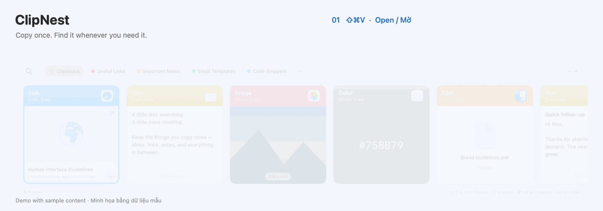
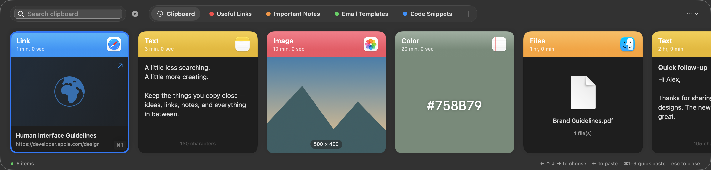
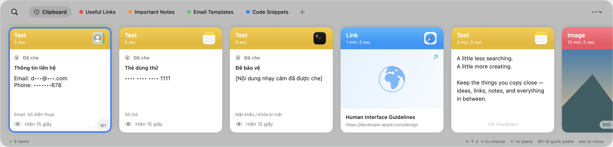

<p align="center">
  
</p>

<h1 align="center">ClipNest</h1>

<p align="center">
  <strong>Copy một lần. Tìm lại bất cứ lúc nào.</strong><br>
  Copy once. Find it whenever you need it.
</p>

<p align="center">
  Một góc nhỏ cho mọi thứ bạn copy trên Mac.<br>
  A little home for everything you copy on your Mac.
</p>

<p align="center">
  
  
  
</p>

<p align="center">
  <a href="https://github.com/hieupnvmg/ClipNest/releases/latest"><strong>↓ Tải cho Mac · Download for Mac</strong></a>
  &nbsp; · &nbsp;
  <a href="https://github.com/hieupnvmg/ClipNest/issues">Góp ý · Feedback</a>
</p>

<p align="center">
  <a href="#tiếng-việt">Tiếng Việt</a> &nbsp; | &nbsp; <a href="#english">English</a>
</p>



<details>
<summary>Xem ảnh tĩnh · See still screenshots</summary>


</details>

<details>
<summary>Xem giao diện tối · See dark appearance</summary>



</details>

## Tiếng Việt

Bạn vừa copy một đường link, rồi copy tiếp một đoạn văn và mất nội dung trước đó? **ClipNest giữ lại lịch sử clipboard để bạn tìm và dùng lại ngay khi cần.** Không cần tài khoản, không đồng bộ iCloud.

### Mở. Gõ. Dán.

Nhấn **`⇧⌘V`** → gõ từ khóa → chọn nội dung → nhấn **`Enter`**.

| | Dành cho công việc hằng ngày |
| :--- | :--- |
| **Lưu những gì cần giữ** | Văn bản, đường link, ảnh, mã màu và tham chiếu file trong một lịch sử dễ xem. |
| **Tìm lại thật nhanh** | Gõ ngay khi mở, dùng phím mũi tên để chọn hoặc `⌘1`–`⌘9` để dán nhanh. |
| **Sắp xếp bằng pinboard** | Gom mẫu trả lời, ghi chú và link thường dùng thành từng nhóm. |
| **Dán theo ý bạn** | Dán giữ định dạng hoặc chọn văn bản thuần. |
| **Gọn trên màn hình** | Bảng clipboard ở cạnh dưới, hỗ trợ sáng/tối và giao diện Liquid Glass. |
| **Tùy chỉnh cho quen tay** | Đổi phím tắt, độ trong suốt, bật khởi động cùng macOS và cập nhật trong app. |
| **Chủ động với dữ liệu** | Che nội dung nhạy cảm, loại trừ ứng dụng, tạm dừng ghi nhận, xem dung lượng và xóa lịch sử. |

### Cài trong một phút

1. [Tải bản mới nhất](https://github.com/hieupnvmg/ClipNest/releases/latest), chọn file **`.dmg`**.
2. Mở DMG, kéo **ClipNest** vào **Applications** rồi mở app.
3. Để dán trực tiếp sang app khác, cho phép ClipNest tại **System Settings → Privacy & Security → Accessibility**. Khi chưa cấp quyền, bạn vẫn có thể copy một mục từ ClipNest và dùng `⌘V` để dán.

**Yêu cầu:** Mac dùng chip Apple Silicon (M1 trở lên), macOS 13+. Chưa có bản Intel. App chưa được Apple notarize; nếu macOS chặn khi mở, xem [hướng dẫn của Apple](https://support.apple.com/102445).

### Chỉnh theo cách bạn dùng Mac

| Trong Settings | Bạn có thể |
| :--- | :--- |
| **Appearance** | Chọn **Standard / Liquid Glass**, chỉnh độ trong suốt. Liquid Glass chính chủ có trên macOS 26+; macOS cũ dùng nền mờ dự phòng. |
| **Startup** | Bật **Launch at login** để mở cùng macOS. Nếu cần, chọn **Open Login Items…** để xác nhận với hệ thống. |
| **Open Clipboard** | Chọn **Change…** để đổi phím tắt hoặc **Reset** về `⇧⌘V`. |
| **Updates** | Kiểm tra bản mới hoặc bật kiểm tra tự động; bạn xác nhận trước khi cài. |
| **Clipboard Storage** | Xem dung lượng và dùng **Clear** để xóa toàn bộ lịch sử, gồm cả mục đã ghim, sau khi xác nhận. |

### Những phím bạn sẽ hay dùng

| Phím | Thao tác |
| :--- | :--- |
| `⇧⌘V` | Mở / đóng ClipNest; có thể đổi trong Settings |
| Gõ sau khi mở | Tìm trong lịch sử |
| `←` `→` hoặc `↑` `↓` | Chọn mục, kể cả khi đang ở ô tìm kiếm |
| `Enter` | Dán mục đang chọn |
| `⌘1`–`⌘9` | Dán nhanh một trong chín mục đầu |
| `⌘F` | Quay lại ô tìm kiếm |
| `Esc` | Đóng bảng clipboard |

### Nội dung nhạy cảm được xử lý thế nào?

**Chỉ che khi hiển thị — vẫn lưu và dán nguyên bản.** Tự bảo vệ nội dung nhạy cảm bật mặc định. App nhận diện một số mẫu email, số điện thoại, số thẻ thanh toán, mật khẩu có ngữ cảnh, API key/token và khóa riêng tư.

- Email, số điện thoại và số thẻ được che một phần; mục có mật khẩu hoặc khóa bí mật nhận diện được sẽ che toàn bộ.
- Chọn **Hiện tạm 15 giây** để xem; đóng bảng sẽ che lại. Cần hiện tạm trước khi kéo thả hoặc chỉnh sửa mục đang che.
- Nhận diện có thể nhầm hoặc bỏ sót. Mật khẩu đứng riêng chưa chắc được nhận diện; app chưa đọc chữ trong ảnh.

Lịch sử nằm trên từng Mac và **không có mã hóa riêng ở tầng ứng dụng**. Che nội dung không mã hóa bản gốc. ClipNest không tải lịch sử lên máy chủ; kết nối mạng của app phục vụ kiểm tra và tải cập nhật từ GitHub. Bạn có thể tắt kiểm tra tự động trong Settings.

Ứng dụng trong danh sách loại trừ và clipboard được đánh dấu bí mật/tạm thời vẫn bị bỏ qua. File được lưu dưới dạng tham chiếu; nếu file gốc bị di chuyển hoặc xóa, tham chiếu có thể không còn dùng được.

<details>
<summary>Xem ví dụ nội dung được che</summary>



</details>

**Có ý tưởng hoặc gặp lỗi?** [Mở một issue](https://github.com/hieupnvmg/ClipNest/issues) để chia sẻ với mình.

---

## English

Copied a link, then copied something else and lost the first one? **ClipNest keeps your clipboard history close, so you can find and reuse it whenever you need it.** No account required. No iCloud sync.

### Open. Type. Paste.

Press **`⇧⌘V`** → type to search → select an item → press **`Enter`**.

| | Made for everyday work |
| :--- | :--- |
| **Keep what you copy** | Browse text, links, images, colors, and file references in one place. |
| **Find it quickly** | Type as soon as the panel opens, select with arrow keys, or quick-paste with `⌘1`–`⌘9`. |
| **Organize with pinboards** | Group your go-to replies, notes, and links. |
| **Paste your way** | Keep formatting or paste as plain text. |
| **Stay out of the way** | A bottom-of-screen panel with light, dark, and Liquid Glass appearances. |
| **Make it feel familiar** | Customize the shortcut and transparency, launch at login, and update in the app. |
| **Stay in control** | Mask sensitive content, exclude apps, pause capture, check storage, and clear history. |

### Install in a minute

1. [Get the latest release](https://github.com/hieupnvmg/ClipNest/releases/latest) and download the **`.dmg`** file.
2. Open the DMG, drag **ClipNest** into **Applications**, and launch it.
3. For direct pasting into other apps, enable ClipNest in **System Settings → Privacy & Security → Accessibility**. Without permission, you can still copy an item from ClipNest and paste it with `⌘V`.

**Requires:** an Apple Silicon Mac (M1 or later), running macOS 13+. An Intel build is not available. The app is not notarized by Apple yet; if macOS blocks it, follow [Apple’s instructions](https://support.apple.com/102445).

### Make it yours

| In Settings | What you can do |
| :--- | :--- |
| **Appearance** | Choose **Standard / Liquid Glass** and adjust transparency. Native Liquid Glass requires macOS 26+; earlier versions use a frosted background. |
| **Startup** | Enable **Launch at login**. If approval is required, use **Open Login Items…** to finish in macOS Settings. |
| **Open Clipboard** | Use **Change…** to record a shortcut, or **Reset** to restore `⇧⌘V`. |
| **Updates** | Check manually or enable automatic checks; installation requires your confirmation. |
| **Clipboard Storage** | See storage usage and use **Clear** to delete all history, including pinned items, after confirmation. |

### Handy shortcuts

| Shortcut | Action |
| :--- | :--- |
| `⇧⌘V` | Toggle ClipNest; customizable in Settings |
| Type after opening | Search history |
| `←` `→` or `↑` `↓` | Select an item, even while the search field is focused |
| `Enter` | Paste the selected item |
| `⌘1`–`⌘9` | Quick-paste one of the first nine items |
| `⌘F` | Focus search |
| `Esc` | Close the clipboard panel |

### How sensitive content is handled

**Masked on screen. Saved and pasted in its original form.** Sensitive-content protection is enabled by default. It recognizes some email addresses, phone numbers, payment-card numbers, passwords with context, API keys/tokens, and private keys.

- Emails, phone numbers, and card numbers are partially masked. An item containing a recognized password or secret is hidden in full.
- Reveal an item for **15 seconds**; closing the panel hides it again. Reveal is required before dragging or editing a masked item.
- Detection can produce false positives or miss content. A standalone password may not be recognized, and text inside images is not scanned.

History stays on each Mac, **without app-level encryption**. Masking does not encrypt the stored original. ClipNest does not upload your history; app network connections are used to check for and download updates from GitHub. Automatic checks can be disabled in Settings.

Excluded apps and clipboard content marked as secret or temporary are still skipped. Files are stored as references; moving or deleting the original file may break the reference.

**Have an idea or found a bug?** [Open an issue](https://github.com/hieupnvmg/ClipNest/issues).

---

<details>
<summary>Tự build · Build it yourself</summary>

Build on macOS with Apple Command Line Tools and Swift 5.9 or later. For native Liquid Glass, use an SDK with macOS 26 support.

```sh
git clone https://github.com/hieupnvmg/ClipNest.git
cd ClipNest
./build.sh
../ClipNest.app/Contents/MacOS/ClipNest --self-test
```

The app is created next to the repository. Tests use temporary data and do not modify your real clipboard history. More details: [Development notes](docs/DEVELOPING.md).

</details>

<p align="center">
  Made for Mac by <a href="https://github.com/hieupnvmg">hieupn</a>.<br>
  <a href="#clipnest">↑ Về đầu trang · Back to top</a>
</p>
